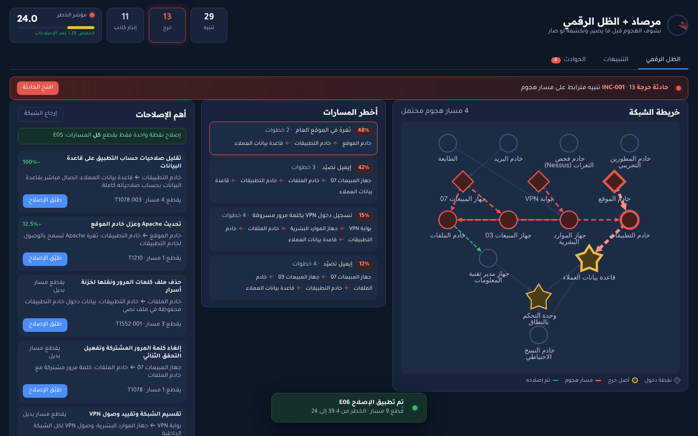

<p align="center"></p>

# مرصاد + الظل الرقمي

**فريق منارة شراع · هاكاثون شراع 2026**

**نشوف الهجوم قبل ما يصير، ونكشفه لو صار.**

منصة ذكية لمحلل مركز العمليات الأمنية (SOC)، تركّز على **شبكات الشركات المبنية على Windows وActive Directory**، وتكشف سلسلة هجوم كاملة: من إيميل التصيّد، إلى سرقة بيانات الدخول، إلى التحرك داخل الشبكة، إلى تسريب البيانات.

- **الظل الرقمي:** نسخة افتراضية من الشبكة تكتشف مسارات الهجوم المحتملة، وأقل عدد إصلاحات يقطعها، وتحاكي أثر كل إصلاح (What-If).
- **مرصاد:** يفرز تنبيهات Splunk، ويعلّم الإنذارات الكاذبة مع السبب، ويدمج التنبيهات المكررة، ويرفع أولوية التنبيه إذا كان جهازه على مسار هجوم.
- **الحوادث:** يجمع التنبيهات المترابطة في حادثة وحدة، ويجاوب على **الأسئلة الخمسة: من؟ متى؟ كيف؟ لماذا؟ ماذا فعل؟**
- **فلترة حسب المصدر:** الأجهزة، والجدار الناري، والشبكة، والخوادم، والهوية والدخول، والبريد.
- **طبقة ذكاء اصطناعي قابلة للتبديل:** نموذج محلي (Ollama) للحفاظ على سرية البيانات، أو سحابي، أو بدون نموذج.

## البيانات التجريبية

- **29 تنبيه** في `data/alerts.json`: سلسلة هجوم من 15 تنبيه (منها تكرارين)، و11 إنذار كاذب (8 منها تشبه الهجوم: فحص Nessus المصرّح، وCrowdStrike يقرأ ذاكرة LSASS، والنسخ الاحتياطي الليلي...)، و3 تنبيهات حقيقية منخفضة ومتوسطة.
- **8 استثناءات** في `rules/severity_rules.json` تفرّق بين الهجوم والنشاط المصرّح اللي يشبهه.
- **29 تقنية MITRE** في `rules/mitre_mapping.json` مع مصدر السجل ورقم الحدث واستعلام Splunk، وملخصها في [`docs/detections.md`](docs/detections.md).
- كل تنبيه فيه الإجابة المتوقعة (`expected_severity` و`expected_false_positive`)، والاختبارات تقارن نتيجة النظام فيها.

> ملاحظة صريحة: دقة 100٪ على هذي البيانات طبيعية لأن البيانات والقواعد مبنية مع بعض. الاختبار الحقيقي للدقة يكون على بيانات يكتبها شخص ثاني ما شاف القواعد.



## التشغيل السريع

يحتاج Python 3.11+ و Node.js 18+.

```bash
# 1) الباك إند
cd backend
pip install -r requirements.txt
uvicorn app.main:app --reload --port 8000
# التوثيق التفاعلي: http://localhost:8000/docs

# 2) الواجهة (في نافذة ثانية)
cd frontend
npm install
npm run dev
# افتح: http://localhost:5173
```

الاختبارات: من مجلد `backend` شغّل `pytest -q`.

## تشغيل الباك إند على Windows (خطوة بخطوة)

افتح **cmd** (مو PowerShell) داخل مجلد المشروع `mursad`:

```bat
cd backend
py -m venv .venv
.venv\Scripts\activate
pip install -r requirements.txt
uvicorn app.main:app --reload --port 8000
```

- النجاح: تشوف `Uvicorn running on http://127.0.0.1:8000`.
- جرّب في المتصفح: `http://localhost:8000/docs`.
- المرة الجاية تكفي الأوامر: `cd backend` ثم `.venv\Scripts\activate` ثم `uvicorn app.main:app --reload --port 8000`.
- اترك النافذة مفتوحة، وشغّل الواجهة من نافذة ثانية (`cd frontend` ثم `npm install` ثم `npm run dev`).

## فحص ملفات الفريق قبل الدمج

قبل ما تحط أي ملف جديد من الفريق مكان القديم، افحصه (من مجلد mursad والبيئة مفعّلة):

```bash
python tools/validate_data.py --alerts "مسار/ملف/خالد.json"
```

- ❌ خطأ: لازم يتصلّح قبل الدمج (حقل ناقص، جهاز مو موجود في الشبكة، صيغة JSON غلط)
- ⚠️ تنبيه: يشتغل بس فيه ربط ناقص (قاعدة بدون خطورة، تقنية MITRE مو موجودة)
- 📊 لو التنبيهات فيها `expected_severity` و`expected_false_positive`، يطلع لك دقة النظام مقارنة بالإجابات المتوقعة

بدون خيارات يفحص الملفات الحالية في `data/` و`rules/`.

## تفعيل النموذج المحلي (اختياري)

1. ثبّت [Ollama](https://ollama.com) وحمّل نموذج يدعم العربي، مثلاً: `ollama pull qwen2.5:7b`
2. انسخ `.env.example` باسم `.env` وغيّر: `LLM_PROVIDER=ollama`
3. أعد تشغيل الباك إند. الشرح في صفحة التنبيه بيطلع من النموذج، ولو تأخر يرجع للقالب الجاهز.

## الواجهات البرمجية

| الطريقة | المسار | الوظيفة |
| --- | --- | --- |
| GET | `/api/network` | الشبكة كاملة للرسم |
| GET | `/api/shadow/analysis` | المسارات، مؤشر الخطر، أقل قطع، التوصيات |
| POST | `/api/shadow/whatif` | محاكاة إصلاحات بدون حفظ |
| POST | `/api/shadow/fix` | تطبيق إصلاح (يأثر على أولويات التنبيهات) |
| POST | `/api/shadow/reset` | إرجاع الشبكة لحالتها الأصلية |
| GET | `/api/alerts` | كل التنبيهات بعد التحليل، مرتبة حسب الأولوية |
| GET | `/api/alerts/{id}` | تفاصيل تنبيه مع الشرح |
| GET | `/api/incidents` | الحوادث (قصص الهجوم) مع الأسئلة الخمسة |
| POST | `/api/alerts/ingest` | استقبال تنبيه من Splunk Webhook أو بصيغتنا |

## كيف تنحسب الأشياء

- **احتمال نجاح الخطوة** = 1 − difficulty، و**احتمال المسار** = حاصل ضرب خطواته.
- **مؤشر الخطر (0-100)** = مجموع (أعلى احتمال وصول لكل أصل حرج × أهميته) ÷ مجموع أهمية الأصول الحرجة × 100.
- **أقل قطع (Min Cut):** أقل عدد حواف لو انصلحت ما يبقى أي مسار من نقاط الدخول للأصول الحرجة.
- **رفع الأولوية:** أصل حرج = +1 (أقلها عالية)، على مسار وقريب من أصل حرج (خطوتين أو أقل) = +1، عنوان مشبوه = +1، وحادثة من 3 تنبيهات أو أكثر تتبع مسار معروف = حرجة. القواعد كلها في `rules/severity_rules.json`.
- **الاستثناءات:** نشاط يطابق شروط استثناء (مصدر معين، مستخدم خدمة، نص في السجل، عدد محاولات أقل من الحد، أو وقت محدد) ينعلّم إنذار كاذب مع السبب، وما ينحذف.
- **التكرار:** نفس القاعدة على نفس الجهاز خلال 10 دقائق = تنبيه واحد مع العدد.

## الأدوات والمصادر

| الجانب | المستخدم |
| --- | --- |
| الباك إند | Python، FastAPI، Uvicorn، NetworkX (رسم مسارات الهجوم) |
| الواجهة | React، Vite، Cytoscape.js |
| الذكاء الاصطناعي | Ollama (نموذج محلي مثل qwen2.5)، مع شرح قالب جاهز عند الفشل |
| الاختبار | pytest، وسكربت `tools/validate_data.py` |
| المراجع الأمنية | MITRE ATT&CK، وصيغة تنبيهات Splunk |
| البيانات | وهمية كلها، كتبها الفريق (`data/`)، ولا فيها بيانات شخصية |
| التطوير | كتابة الكود بمساعدة الذكاء الاصطناعي ومراجعة الفريق |

لا توجد مفاتيح في الملفات: `.env` داخل `.gitignore`، و`.env.example` بلا قيم.

## تعليمات المقيّم والسيناريوهات

- [`docs/evaluator_guide.md`](docs/evaluator_guide.md): كيف تشغّل المشروع وتجرّبه
- [`docs/test_scenarios.md`](docs/test_scenarios.md): السيناريوهات العادية والحدّية والفشل

## الفريق

| العضو | الدور |
| --- | --- |
| سبأ | التطوير التقني (FastAPI، React، الربط) |
| براء | التحليل الأمني وقواعد الخطورة |
| خالد | البيانات والاختبار |
| عبدالله | الأدوات والتكامل الأمني (Splunk، Wazuh، MITRE ATT&CK) |
| ياسر | التسويق وتجربة المستخدم والعرض |

## الخطوات الجاية

- ربط Splunk الحي عبر Webhook Alert Action إلى `/api/alerts/ingest`
- قراءة الشبكة من فحص حقيقي (Nmap) بدل الملف
- الخداع الأمني (Cyber Deception): أجهزة وبيانات وهمية على مسارات الهجوم لكشف المهاجم مبكراً
